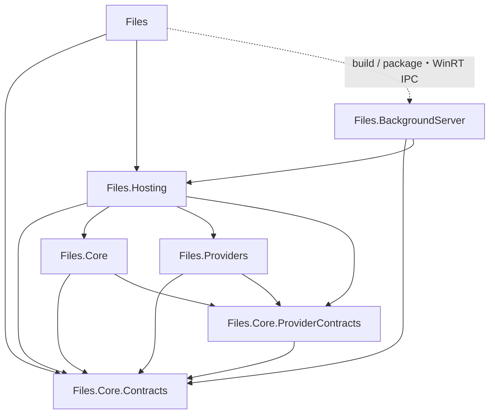

# Core Files Architecture (WIP)



## Consuming the package

`ReFiles.Core` provides UI-independent storage, browsing, and optional item capabilities for .NET 10 on Windows. Reference `ReFiles.Providers` alongside `ReFiles.Core` to use Windows Shell, FTP, and archive providers. Set `WindowsSdkPackageVersion` to `10.0.26100.67-preview` before restoring. The API is evolving; pin your package version.

```csharp
using Files.Core;
using Files.Core.Capabilities;
using Files.Core.Capabilities.Content;
using Files.Core.Storage;

await using var runtime = new FilesCoreBuilder().AddWindowsStorage().Build();
await using var item = await runtime.Workspace.ResolveAsync(new StorageAddress("file", @"C:\example.txt"));

if (item.Get<IReadableContent>() is { } content)
{
    await using var stream = await content.OpenReadAsync();
    // Read the content here.
}
```

Capabilities are optional and borrowed. Dispose the runtime, resolved models, and returned streams; the model owns its capability collection.

See [package requirements](src/Files.Core/PACKAGE.md) for platform and native archive dependencies, and [capability documentation](docs/subsystems/capabilities.md) for composition and extension contracts.

## Extending the package

To add a custom capability, define an interface derived from `ICapability` and register its implementation and borrowed view before building the runtime:

```csharp
var builder = new FilesCoreBuilder();

builder.Capabilities
    .Add<IChecksumSource>(new ChecksumSourceFactory())
    .SetBorrowedView<IChecksumSource>(static inner => new ChecksumSourceView(inner));
```

A borrowed view is required for every custom capability. It wraps the final composed implementation and exposes only the intended capability, without disposal or unrelated interfaces. If the view subscribes to events, return `new BorrowedCapabilityView<IChecksumSource>(view, release)` so the model owner detaches those subscriptions.

Provider authors can target `ReFiles.Core.ProviderContracts` without referencing the runtime implementation. Built-in registration methods such as `AddWindowsStorage()` are extensions supplied by `ReFiles.Providers`.
