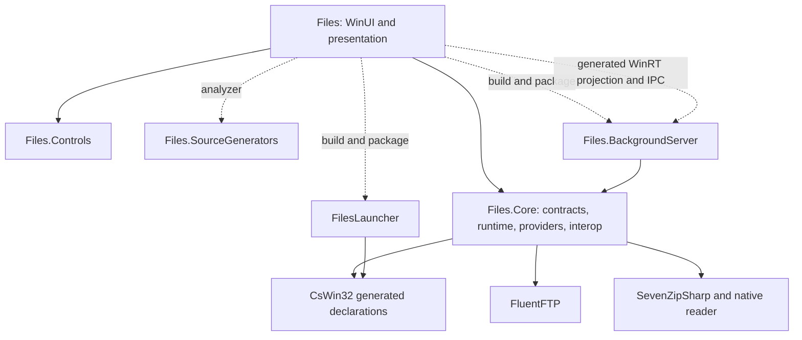
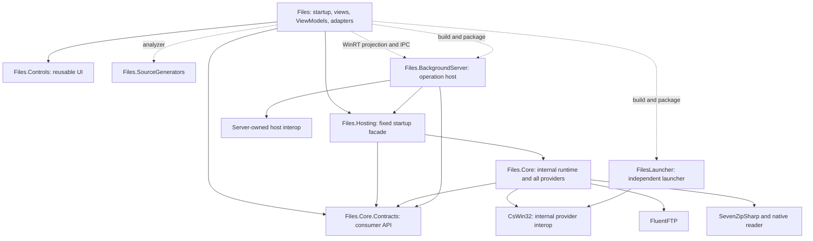
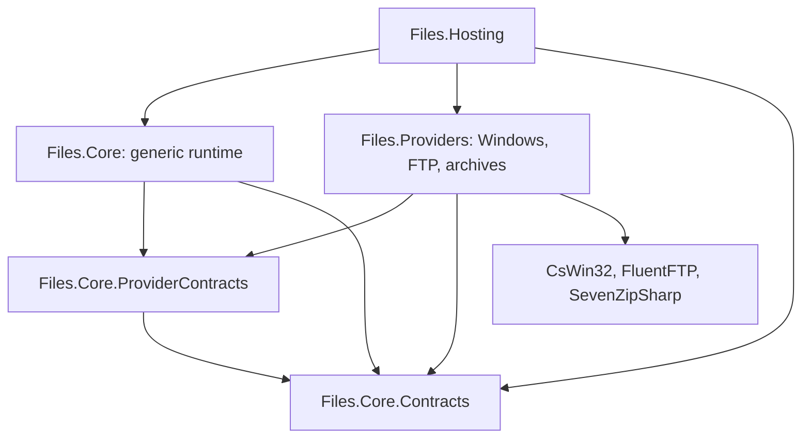

# Capability boundaries: issues and proposed dependencies

Status: the application consumer boundary is implemented. Files and BackgroundServer reference consumer Contracts and Hosting, use session/service interfaces, and reject Core, Providers, ProviderContracts and backend compiler references. Windows UI contracts and settings persistence have migrated; window ownership and composition remain in Files. Core and Providers remain independently extensible through ProviderContracts, and each executable/provider owns internal native declarations. See [project split status](project-split.md) for the current implementation, public API baselines, package/Native AOT CI checks, and remaining installed-app validation.

The review below records the original architecture and its proposed remedies; its present-tense descriptions are historical unless explicitly marked with an implementation update.

The goal is to prevent application consumers from bypassing composed item capabilities through ordinary statically typed code, and to make changes to that boundary explicit and reviewable. Capability discovery currently describes optional functionality; it is not an authorization or process-isolation mechanism.

## Original reviewed solution

Arrows indicate compile-time dependencies unless labeled otherwise. Build/package edges do not grant normal C# access to the referenced executable. External framework and logging dependencies are omitted.



| Project | Current responsibility and contents |
| --- | --- |
| `Files` | App startup, DI, XAML, ViewModels, presentation adapters, settings, Windows UI integration, and the WinRT operation client. `App` constructs `WindowsStorageSource` and `FilesCoreBuilder`. Some adapters also perform direct filesystem/native access. |
| `Files.Core` | Consumer and provider contracts; application/window/tab/pane sessions; browsing; AppModels; workspace; capability registry, factories, combiners, wrappers and caches; operation routing/transfers; Windows, FTP and archive providers; CsWin32 inputs and custom interop. |
| `Files.BackgroundServer` | Out-of-process operation acceptance/execution, progress/control, WinRT transport DTOs, and process-specific composition. It references Core to execute provider operations. |
| `Files.Controls` | Reusable WinUI controls and their visual contracts. It has no Core project reference. |
| `Files.SourceGenerators` | Compile-time generation, referenced by Files as an analyzer rather than a runtime library. |
| `FilesLauncher` | Separate Native AOT launcher/integration executable with its own CsWin32 inputs. Files builds/packages it without referencing its output assembly. |
| Test and benchmark projects | Consumer behavior, provider integration, presentation, controls, accessibility, and performance. Core currently grants internal access to unit tests and benchmarks. |

The same Core assembly currently exposes both consumer models and the mechanisms that construct or bypass them. Folder boundaries express intent but do not restrict access.

## Proposed minimum boundary

Keep presentation in `Files`. Keep Windows, FTP, archives, and the generic runtime together in the existing `Files.Core` implementation assembly initially. Add consumer contracts and a narrow hosting facade; do not add one project per provider or a ProviderContracts project for this configuration.



Provider and launcher interop use independently generated declarations; the graph does not propose a shared public interop assembly. The server also needs private host-only declarations for activation/window/tray integration once Core's public declarations disappear. Restrict these declarations to process hosting rather than storage APIs. Native reader deployment is a packaging concern, not permission for Files to reference its managed API.

| Project | Proposed contents and public surface | Benefit |
| --- | --- | --- |
| `Files.Core.Contracts` | Consumer AppModel interfaces; capability interfaces and a discovery-only reader; storage identity/value types; source descriptors; application/session/browse interfaces and immutable snapshots; operation requests/monitoring; view-settings/cache abstractions genuinely needed by consumers; narrow Windows interaction contracts without generated native types. | Files cannot name raw providers or model construction APIs through this assembly. A changed implementation does not automatically enlarge the consumer API. |
| `Files.Core` | Existing generic runtime plus all provider implementations. Keep the deliberate provider/composition SDK public for NuGet extension authors. Raw items, sources, `ItemContext`, model factories and registration remain in Core; consumer Contracts must not expose them. Keep native declarations and implementation-only types internal where possible. | Preserves implementation reuse and existing internal collaboration while preserving explicit NuGet extension authority. Files must ultimately have no compiler reference to this assembly; that application migration is still pending. |
| `Files.Hosting` | Small, allowlisted startup/shutdown facade. Create UI-process and operation-host runtimes from typed options and borrowed consumer services; return consumer interfaces only. Do not expose builders, registries, raw sources, backend selection, service locators, or arbitrary registration callbacks. | Files retains startup ownership without acquiring provider implementation access. Hosting can use a small public Core bootstrap entry or a narrowly reviewed friend-assembly grant. |
| `Files` | Existing presentation, UI-specific DI, localization, visual resources, WinRT client/projection and gestures. `App` invokes Hosting and retains a consumer runtime interface. Supply credentials, UI callbacks and supported configuration through explicit contracts. | No separate `Files.Presentation` assembly is required to hide Core. All code in Files sees only the intentionally small facade and consumer API. |
| `Files.BackgroundServer` | Existing WinRT API, transport conversion, accepted-job ownership, progress and cancellation. Obtain execution services through a server-specific Hosting entry rather than constructing raw providers. | Preserves process ownership and execution semantics while reducing raw implementation references. |
| Controls, generators, launcher | Retain their current responsibilities and deployment relationships. | Avoids changes unrelated to the storage boundary. |

The names of new interfaces, options and entry points remain to be designed. Existing concrete sessions cannot simply be copied into Contracts: introduce consumer interfaces or intentionally shared value types instead. Consumer contracts must not refer back to Core, Hosting, FluentFTP, SevenZipSharp, or generated Win32 types, including through generic arguments, base interfaces, events, callbacks and exceptions intended for consumer handling.

### Why Files.Presentation is unnecessary here

Separating presentation was necessary in the earlier proposal only because the executable itself referenced implementation assemblies to compose providers. Hosting removes that requirement. Files can contain both startup and presentation when its only storage-facing references are Contracts and Hosting.

Every class in Files can still call the Hosting facade. Keep that API limited to reviewed runtime construction and disposal, not general provider creation. If even startup calls must be inaccessible to ViewModels by the C# type system, a separate assembly would be required; namespace/folder rules or an analyzer are weaker alternatives. This stricter restriction is separate from preventing direct provider access.

Contracts-only *business consumption* still needs a startup entry somewhere. A separate executable/bootstrapper that injects the runtime would be necessary if Files were forbidden from referencing even Hosting. Reflection-based discovery is unnecessary for the proposed facade.

### Provider projects and the implemented stricter boundary

The checkout now uses the stricter `Files.Providers` plus `Files.Core.ProviderContracts` variant shown below. One project per Windows/FTP/archive provider does not strengthen the Files boundary once Files cannot reference any implementation assembly. Keep them together unless independent deployment, platform targeting, package weight, external provider authorship, or restrictions within Core justify a split.

The earlier minimum design did **not** make CsWin32 inaccessible to generic code inside Core; the implemented provider split now removes Core's CsWin32 and backend references. Internal access is assembly-wide. Keep interop in provider-owned folders and check its permitted callers; do not describe this convention as compiler isolation.

If generic Core must be unable to call native/provider code, extract a single `Files.Providers` assembly first. Add `Files.Core.ProviderContracts` for raw item/source and registration contracts shared by Core and Providers. Both depend on consumer Contracts; Hosting references both implementations. Core must not reference Providers, and Providers must not depend on concrete Core runtime classes. Address current factory/context dependencies through that provider contract rather than introducing a cycle. Individual provider assemblies can follow later if needed.



In this stricter variant, ProviderContracts holds the provider-facing raw model/source contracts, capability factory/context and registration abstractions, and the model-adaptation hooks needed by provider modules. Core implements orchestration and adaptation; Providers implements storage, native operations and backend integration. Keeping these contracts separate prevents Files from gaining raw access merely by referencing consumer Contracts. The cost is two additional projects and more explicit cross-assembly collaboration. Files' references remain unchanged.

### Compile references and deployment

Disable implicit transitive project references for Files and validate the resolved compiler reference set, not just literal `ProjectReference` entries. Explicitly permit Contracts, Hosting and Controls; reject Core/provider assemblies and their implementation package APIs. Apply equivalent compile-asset rules and checks when distributing NuGet packages: the project-reference switch alone does not control package compile assets.

Core and its native/runtime dependencies must still be copied or published with the application and server. Verify Debug build, packaged publish, Native AOT/trimming where applicable, and each supported architecture before accepting reference-hiding settings. `PrivateAssets` and `ReferenceOutputAssembly` are dependency/build controls, not runtime security boundaries; do not hide a dependency by accidentally dropping its runtime assets.

## Confirmed issues and escape paths

Paths below describe the original reviewed responsibility layout: consumer declarations now live under `src/Files.Core.Contracts`, provider-facing contracts under `src/Files.Core.ProviderContracts`, and Windows/FTP/7-Zip implementations under `src/Files.Providers`. Generic runtime code remains in `src/Files.Core`. These are architectural exposures, not a claim that each path bypasses an existing authorization policy.

### 1. Arbitrary capability types resolve to raw CoreModels

Implemented: discovery and registration now require `class, ICapability`, and shared runtime validation rejects implementation classes and the marker itself before cache lookup or registration. Registry no longer adopts CoreModel interfaces automatically. FTP and archive modules explicitly register content factories, and an unbound `ItemContext.GetCapability<T>()` no longer casts its CoreModel. Custom capabilities must use derived interfaces and explicit factory registration; see [`../subsystems/capabilities.md`](../subsystems/capabilities.md).

Previously, `ICapabilities`, Registry and Builder accepted any class type, and Registry automatically returned compatible CoreModels. This allowed `Get<object>()`, `Get<IStorable>()`, and compatible concrete-type requests to expose the original CoreModel outside its composed wrappers. The new contract removes that arbitrary-type path; casts on explicitly registered results remain issue 2, and raw source/composition access remain issues 3 and 4.

### 2. A capability result can expose other functionality through casts

Implemented for built-in capabilities: Registry projects the final composed result through a dedicated borrowed adapter before caching it. FTP and archive content no longer expose raw storage interfaces, and Windows read access cannot be cast to write access. Projection happens after factories, combiners and wrappers; the original implementations remain tracked for owner-controlled disposal. Internal archive-input and property-batching contracts are preserved without exposing public administrative roles. Writable streams returned by read capabilities are wrapped as caller-owned read-only streams.

Custom capability contracts register their final borrowed adapters through `CapabilityBuilder.SetBorrowedView<TCapability>`, using the same mechanism as built-in defaults. Registry applies the registered factory after all wrappers and rejects null or disposable views while preserving implementation lifetimes. Views for arbitrary interfaces are not synthesized; without a registration, custom implementations are returned unchanged and must already satisfy the borrowed contract. Replacing a built-in view is deliberate composition authority and must preserve its access/resource semantics. Raw registration/composition access is tracked in issue 4; this change does not establish a security boundary against provider code.

### 3. Workspace exposes raw sources and source administration

`Storage/Workspace/IStorageWorkspace.cs` exposes `Sources` as `IStorageSource` instances, whose resolve methods return raw items. `SourceRegistry` additionally exposes `IStorageSourceRegistry.AddSource(IStorageSource)`. `StorageWorkspace` implements both interfaces, so deleting only the property leaves an interface-cast path if both contracts remain public to consumers.

Expose source descriptors and AppModel resolution. Keep raw registration behind Hosting/internal ownership, and provide typed connection-management operations for dynamic FTP or future sources. Do not return an object implementing a hidden administrative role through a consumer interface when that role remains publicly accessible elsewhere.

### 4. Provider composition and contexts are public

`FilesCoreBuilder.Capabilities`, `AddStorageSource`, provider registration methods, public factories/wrappers/combiners, `CapabilityRegistry.CreateCapabilities`, and `ItemContext` are accessible to Files. `ItemContext` still carries public `Source` and `CoreModel` properties. Its former unbound `GetCapability<T>()` raw-cast fallback was removed with issue 1.

These are implementation/composition facilities, not consumer APIs. Keep them behind Core and Hosting. Hosting must not re-expose these facilities as callbacks, options or an `IServiceProvider` escape hatch.

### 5. Consumers can construct models outside the configured runtime

`StorableModel`, `FileModel`, `FolderModel`, and `StorableModelFactory` expose construction APIs accepting raw items/sources or independently chosen capability registries. `StorableModel` is extensible. Consumers can construct a different model graph without the runtime's configured composition and ownership.

Keep production implementations and construction internal, seal them where extension is unnecessary, and return consumer interfaces. Tests can use explicit test doubles; do not expose raw production construction solely for testing. Public consumer interfaces still permit custom implementations and do not prove that an arbitrary object came from a trusted runtime.

### 6. Borrowed capability access includes destruction authority

Implemented: item models expose `ICapabilities` through a separate facade that implements neither the owning `IOwnedCapabilities` interface nor disposal interfaces. The owning collection remains private to the model and is disposed before the raw storage item. `IOwnedCapabilities` remains the explicitly owned composition result for builders/model construction, which is separately tracked in issues 4 and 5.

Built-in capability adapters hide implementation disposal interfaces. `IFolderChangeSource` is now borrowed; its Windows implementation retains disposal for collection ownership. Change-event senders are the borrowed facade rather than the owned implementation. Returned streams, preview results and independently opened models retain their legitimate caller-owned disposal. Custom capability implementations must follow the same borrowed-result contract described in issue 2.

### 7. Runtime and capability contracts expose concrete implementations

`FilesCoreRuntime` exposes concrete `FilesApplicationSession` and Windows-specific preview services. `IArchiveSource.OpenAsync` returns concrete `ArchiveModel`; that class also has a public static `OpenAsync` accepting a raw source, model factory and backend selector. Moving only interface files would retain a Contracts-to-implementation dependency or force unwanted implementation APIs into Contracts.

Introduce consumer runtime/session/archive interfaces and retain constructors/static raw factories internally. Review recursively reachable API types, not just top-level class visibility. Windows-specific behavior may have narrow Windows contracts; being platform-specific alone is not a capability violation.

### 8. Public Windows providers expose native service entry points

`Storage/Windows/WindowsStorageSource.cs` publicly exposes its scheduler, clipboard and drag/drop services. Files constructs the provider in `App.xaml.cs` and consumes concrete Shell services throughout presentation, activation, property pages and settings.

Expose item functionality through capabilities and contextual UI integration through narrow session/service contracts. Menus, clipboard and drop sessions can involve multiple items or a window and need not be forced into an item capability. Keep scheduling, raw source access, native object ownership and provider construction internal.

### 9. CsWin32 declarations escape through Core (resolved)

The reviewed `NativeMethods.json` set `public` to `true`. The generated declarations were part of Core, even though its generator package uses `PrivateAssets="all"`. Files currently imports `Windows.Win32` in settings, property pages, context menus and OLE bridges. BackgroundServer also consumes them in its activation entry points, window validation and tray implementation.

Generate internal declarations and keep custom ABI/COM declarations provider-owned. Move native operations behind explicit adapters. Give BackgroundServer independently generated, internal host-only declarations for activation/window/tray work, or isolate that host integration behind a platform implementation; do not retain Core's public storage interop for this purpose. Preserve typed native handles, SafeHandle semantics, COM ABI and allocator ownership inside each boundary; do not replace typed native arguments with arbitrary pointers merely to remove a project reference. FilesLauncher's independent interop is not a Core leak.

Implemented: Providers, Files, BackgroundServer and Launcher independently generate internal declarations. Public provider signatures expose managed messages/results and borrowed window handles. Core has no native declarations, and reflection tests reject native types in Providers' exported surface.

### 10. UI/native bridges require a real migration

The UI bridge migration is implemented: Providers converts WinRT data packages to its private COM interfaces on the originating STA. Files retains its own window/composition declarations and preview rendering. `Files/Presentation/IBrowseInteraction.cs` exchanges consumer drag/drop/menu interfaces; implementation assembly references have been removed from Files.

Keep WinUI visual ownership in Files and native work in provider/platform adapters. Design the data-transfer, window-context and session contracts before moving code. A platform-specific integration assembly is optional if the bridge genuinely requires WinUI dependencies; do not introduce a WinUI dependency into Core or export raw COM pointers as a shortcut. Validate OLE apartment, message-pump, callback, handle and session lifetimes.

### 11. Direct storage I/O remains in Files (migrated)

`Files/ItemProperties/ItemPropertiesFileSystem.cs` disables RS0030 and performs `File`/`Directory` operations. Settings adapters also use native filesystem APIs. These are existing exceptions to a strict storage boundary, even when locally isolated behind an adapter.

Implemented: filesystem property inspection and settings persistence now use explicit consumer services implemented by Providers. Settings schemas and presentation remain in Files; attribute changes continue through the operation server.

Move item storage semantics into capabilities/application operations and native persistence mechanisms into explicit infrastructure services. Distinguish application-owned settings/log output from user-item access; a blanket ban on every I/O use would incorrectly prohibit legitimate infrastructure. Document and constrain remaining exceptions by responsibility.

### 12. Provider-specific knowledge reaches generic Core code

`Capabilities/Archives/ArchiveSourceFactory.cs` inspects Windows provider types, including the Shell folder/stream distinction. `Application/BrowsePaneSession.Commands.cs` and `Browsing/Locations/ArchiveBrowseLocationHandler.cs` use the internal raw-model access path for archive navigation. `Capabilities/Previews/PreviewRequest.cs` contains internal Windows-specific trust-target matching.

These internal uses are not themselves public raw-model leaks, but they show that provider separation is not a mechanical file move. Represent archive candidates, parent/container navigation and trust matching through the appropriate internal contracts before requiring a provider-independent runtime. Preserve Shell stream behavior and trust checks; do not weaken semantics to simplify dependencies.

### 13. Project references and package dependencies can reopen the boundary

Files directly references Core today; SDK transitivity can also expose implementation assemblies through an intermediate facade. Core currently owns FluentFTP, SevenZipSharp and System.Management dependencies. A facade whose public signatures mention implementation types also requires those dependencies at compile time.

Enforce the proposed compiler-reference allowlist, consumer API closure and package compile/runtime separation. Reject new direct references as well as transitive ones. Verify native 7z deployment independently. A provider becoming public inside an unreferenced implementation assembly must not automatically make it callable from Files.

### 14. Existing checks do not enforce the complete boundary

`Directory.Build.props` applies BannedSymbols to selected projects, while Core must legitimately perform I/O. Existing RS0030 suppressions demonstrate that a local edit can bypass that check. `tests/Files.UITests/PresentationTests/ArchitectureBoundaryTests.cs` tests presentation behavior rather than the complete compiler-reference/public-API boundary. The inspected configuration does not define a public API baseline or dedicated capability-boundary analyzer.

Add checks for resolved references, public API closure/baselines, invalid capability types, raw-result casts, source administration and ownership. Use negative compilation tests for inaccessible implementation APIs and runtime tests for resolution/casting behavior. Namespace-name bans and API-name heuristics alone are insufficient. If Providers remain inside Core, separately enforce permitted interop callers within that assembly.

#### Public API generation and change tracking

Use `Microsoft.CodeAnalysis.PublicApiAnalyzers` for the proposed Contracts and Hosting projects. It compares source symbols against checked-in signature lists during compilation:

| File | Purpose |
| --- | --- |
| `PublicAPI.Shipped.txt` | Released API signatures. |
| `PublicAPI.Unshipped.txt` | API additions and changes for the next release, including explicit removal entries where applicable. |

`RS0016` reports public APIs missing from the lists; `RS0017` reports listed APIs missing from the source. The analyzer's code fix can generate/update the lists across a project or solution. Compilation checks the lists rather than silently rewriting them, so intentional updates appear in the Git diff for review. Configure both diagnostics as errors:

```ini
dotnet_diagnostic.RS0016.severity = error
dotnet_diagnostic.RS0017.severity = error
```

For example, adding `public Stream OpenFileDirectly()` would fail validation until its signature is recorded. Updating the list makes that check pass; the analyzer does not determine whether an API bypasses capabilities. Protect list changes through owner review and retain the dependency/type-boundary checks above. See the [official PublicApiAnalyzers guide](https://github.com/dotnet/roslyn/blob/main/src/RoslynAnalyzers/PublicApiAnalyzers/PublicApiAnalyzers.Help.md).

Use [Microsoft.DotNet.ApiCompat.Tool](https://learn.microsoft.com/en-us/dotnet/fundamentals/apicompat/global-tool) separately to compare built assemblies or NuGet packages against a baseline for API compatibility. Compatibility validation complements source API tracking; it does not establish that an added API belongs in the architecture.

### 15. Validation and access rules can themselves be changed

Developers can edit project references, visibility, analyzer severity/suppressions, API baselines, test exclusions, friend-assembly grants and CI. Core currently grants internal access to unit tests and benchmarks; do not add Files as a friend to simplify migration. A Hosting friend grant, if chosen, is deliberate implementation authority and must be reviewed accordingly.

Protect contracts, Hosting's API, project/build/package configuration, analyzer/suppression policy, API baselines, friend grants and CI through required independent validation and owner review. No CODEOWNERS file was found in the inspected checkout; remote repository rules and administrator bypass permissions were not inspected. Local files alone cannot establish who can merge changes.

### 16. Capability access is not authorization or provenance

Same-process managed code can implement public contracts, create substitute objects, use reflection, add native calls, or access paths learned from metadata. Markers and allowlists do not make provider code trustworthy, and wrappers are effective only when all relevant entry points use them.

Use this design to enforce normal dependencies and detect architectural erosion. If a policy must survive hostile executable code, enforce it at the OS/process/server boundary with validated requests and permissions. A downstream fork can remove local checks; maintaining control over an upstream package does not prevent downstream replacement. No new process split is required solely for this architectural review.

## Validation and migration order

1. Fix capability type admission, direct CoreModel adoption, result-cast escapes and ownership exposure with focused resolution/lifetime tests.
2. Define consumer API closure, including runtime/session/archive and Windows UI interaction contracts. Replace raw workspace sources/registration with descriptors and typed operations.
3. Extract Contracts and add Hosting while leaving providers together. Move App's raw composition behind Hosting and keep presentation in Files.
4. Internalize CsWin32 and raw implementation APIs after replacing Files' native bridges and direct item I/O. Preserve callback/apartment and resource ownership semantics.
5. Enforce compiler references, public API baselines and approved exceptions. Test the actual NuGet/package/publish graph, native dependencies, server projection/IPC, and x64/arm64 deployment.
6. Split Providers from generic Core only if compiler isolation inside the implementation becomes a requirement. Do not claim provider isolation from a folder reorganization.

Acceptance requires ordinary Files code to fail compilation when naming raw sources, contexts, Core model constructors, generated Win32 APIs or reader implementations. Runtime tests must also reject invalid capability types and demonstrate that returned objects cannot expose raw or separately composed functionality through casts. Existing lazy composition, caching, source/model lifetimes, archive nesting, read/write behavior and operation-host ownership must remain correct.
