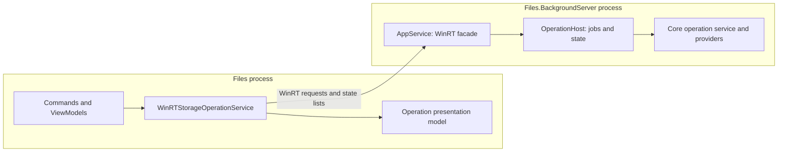

# Proposal: the Files.BackgroundServer server boundary

Status (2026-10-21): Initial Windows command integration is implemented. See [operations.md](operations.md) for current behavior; remaining work is listed at the end.

## Decision

Keep `Files.Core` as a normal .NET library. Use `Files.BackgroundServer` as a process host with a small WinRT facade over internal .NET services. Keep the generated WinRT projection and its client adapter in the existing `Files` project.

The target is server ownership of all user-initiated domain I/O. Separate short, client-owned queries from accepted background operations that survive client termination. The latter include entire file-operation batches, not just individual item calls. The application submits intent and observes state. Both processes can reference `Files.Core`; they do not share its objects or runtime instances.

No additional project is required.

## What the WinRT restriction actually means

The restriction applies to the exported API, including constructors, implemented interfaces, parameters, results, properties, events, and their type arguments. An exported member cannot expose the existing `StorableReference`, `StorageOperationRequest`, `StorageOperationResult`, or `IStorageOperationControl` types directly. Referencing their assembly does not turn those types into WinRT contracts.

Internal implementation can use these types, `Task`, `ValueTask`, cancellation tokens, collections, exceptions, and the existing provider implementations. A private field or an internal constructor may hold or accept a Core service. Public members of an internal implementation type do not thereby become the public WinRT facade.

Some familiar .NET interfaces have WinRT mappings: `IDisposable` maps to `IClosable`, for example. Consequently, the rule is not that every .NET-looking type is forbidden. The actual exported signature and all nested types must have supported WinRT representations. See [C#/WinRT authoring diagnostics](https://learn.microsoft.com/en-us/windows/apps/develop/platform/csharp-winrt/authoring-diagnostics) and the [component type rules](https://learn.microsoft.com/en-us/windows/uwp/winrt-components/creating-windows-runtime-components-in-csharp-and-visual-basic#declaring-types-in-windows-runtime-components).

An `object` parameter is not a way to transmit an arbitrary Core object and cast it back in the other process. A WinRT object is an interface reference, possibly represented by a proxy; it does not transfer an arbitrary CLR object graph.

Older UWP component documentation also discusses UWP runtime restrictions. Those should not be applied wholesale to this full-trust .NET desktop server. The WinRT ABI restrictions still apply to its public contract.

## Baseline findings before the infrastructure change

| Current code or document | Architectural consequence |
| --- | --- |
| `Files.BackgroundServer.csproj` references `Files.Core` | The server can already reuse Core internally. |
| `AppService` only monitors client processes and signals exit when the count reaches zero | This bootstraps activation, but does not yet support work surviving the last client. |
| `Program` discovers all public sealed classes through reflection | Adding public result classes would also put them into the activation-registration list. Registration must become explicit. |
| `FolderBrowserViewModel.ExecuteTrackedStorageOperationBatchAsync` executes the item loop in the app | Remoting individual leaf calls would leave the remainder of a batch dependent on the app process. |
| `StorageOperationTracker` owns cancellation and interruption response sources in the app | Authoritative operation control must move with execution. Graph samples and UI notifications can remain in the app. |
| `AddWindowsStorage` registers both browsing storage and a local operation handler | App composition must distinguish remote operation commands from locally executed operations. |
| Architecture diagrams contain `Core -> Operations`, whereas the server project references Core | Runtime invocation and compile-time dependency direction need separate diagrams. |

The current [operations architecture](operations.md), [ownership rules](ownership-and-lifetime.md), and [Shell scheduling rules](../subsystems/windows-shell.md) support explicit ownership and bounded asynchronous work. The archived [server-operations design](../archive/legacy/server-operations.md) already explores batch submission, value DTOs, revisions, and a recovery journal. These are useful design inputs, but that document is explicitly historical. Its API also needs the pause and interruption behavior now present in the code.

## Project dependencies and runtime calls

Normal .NET references remain:

```text
Files -------------> Files.Core
Files.BackgroundServer --> Files.Core
```

Separately, `Files` consumes the public `Files.BackgroundServer.winmd` through generated C#/WinRT projection code. It must not directly instantiate the server's managed implementation assembly. C#/WinRT distinguishes ordinary managed references from the out-of-process consumption scenario in its [authoring guide](https://github.com/microsoft/CsWinRT/blob/master/docs/authoring.md#consuming-from-c-applications).

The runtime flow is:



`Files.Core` does not reference the server or generated projection. A pure .NET job-service interface in Core can be implemented by the app's client adapter. The server uses composition to call its own internal job service; `AppService` does not implement a Core interface on its public WinRT surface.

## Responsibilities and placement

| Owner | Responsibility |
| --- | --- |
| `Files.Core` | Existing storage identities, leaf requests/results, provider execution, and Shell scheduling. Add reusable pure .NET batch/state list contracts and a job-service abstraction here when implementing this proposal. |
| `Files/Infrastructure/Operations` | `WinRTStorageOperationService`: activation, DTO conversion, reconnection, and translating WinRT async calls into normal .NET calls. No separate client project. |
| `Files/StorageOperations` | Presentation of server state lists: localized text, graph samples, smoothing, commands, and UI notifications. It must not independently decide whether a server job succeeded or is paused. |
| `Files.BackgroundServer` public surface | `AppService` and a small set of request/result types using supported WinRT signatures. |
| `Files.BackgroundServer` internal services | `ServerHost`, `OperationHost`, DTO mapping, per-job execution/control, journal, provider composition, and lifetime coordination. |

The server should compose the providers and operation service it needs, without building the full `FilesCoreRuntime` window/tab/pane graph. Existing `WindowsStorageSource`, `WindowsStorageOperationHandler`, and `StorageOperationService` can be reused. A new universal host framework or DI container is unnecessary.

The app still owns browse state, selection, and presentation. As domain I/O migrates, its data access uses server services. The app's local Core models and the server's provider instances have independent lifetimes; they never share caches or COM objects implicitly.

## Public contract

Start with one externally activatable class, `Files.BackgroundServer.AppService`. Keep operations on that facade initially. Add a separate feature facade only when another actual server responsibility requires one.

The table mixes the implemented facade with remaining details/history design; future methods are marked as planned:

| Member | WinRT result | Meaning |
| --- | --- | --- |
| Constructor with client process ID | `AppService` | Attach a client session; perform only bounded setup. |
| `SubmitStorageOperations(operationId, items[])` | `Guid` | Accept the complete typed storage batch and return its identity promptly. Implemented. |
| `GetOperations()` | `OperationList` | Capture the current bounded set of operation summaries. Implemented. |
| `WaitForOperationChangesAsync(serverInstanceId, knownRevision)` | `IAsyncAction` | Wait for a newer revision or a bounded timeout, then fetch a new state list. Implemented. |
| `GetOperationDetailsAsync(operationId, offset, maxItems)` | `IAsyncOperation<OperationDetailsPage>` | Read a bounded page of item outcomes and current interruption information. |
| `CancelOperation(operationId)` | `Boolean` | Request cooperative cancellation; do not claim the job has already stopped. Implemented. |
| `SetOperationPaused(operationId, paused)` | `Boolean` | Request pause/resume when supported by the backend. Implemented. |
| `ResolveOperationInterruption(operationId, interruptionId, decision, applyToAll)` | `Boolean` | Resolve the displayed interruption, rejecting stale responses. Implemented. |
| `ForgetOperation(operationId)` | `Boolean` | Remove a terminal operation from retained history. Implemented. |
| `Dispose()` | `IClosable` mapping | Detach the client session. Accepted jobs retain server ownership. |

Public async methods return WinRT async interfaces. Internal services retain `Task`/`ValueTask` and cancellation tokens, with the facade adapting through `AsyncInfo.Run`. The current wait uses the non-generic `IAsyncAction`; its completion is a notification, and the state list is read separately. Future async acceptance/details methods must verify the deployed registrations for their custom generic results. The client adapter can expose .NET async methods and an `IAsyncEnumerable` watcher locally. See [IAsyncOperation implementer guidance](https://learn.microsoft.com/en-us/uwp/api/windows.foundation.iasyncoperation-1#notes-to-implementers).

The request header contains the caller-generated operation ID, kind, destination/options, and any explicit optional-value flags. The acceptance receipt contains that operation ID, the server instance ID, and the accepted revision. Keep this acceptance response separate from the eventual operation outcome.

### DTOs and remote references

Use a small value struct for the request header and a separate read-only array parameter for its items. A storage-reference DTO carries:

- source ID;
- provider-specific item ID;
- an explicit optional recovery address: presence, scheme, and value.

Preserve `StorableReference` semantics: the recovery address is a hint, not the identity. The server resolves and validates the reference through its own configured provider. It must not silently substitute an unrelated item currently occupying an old path.

Use explicit WinRT enums, strings, primitive values, and nested value structs for the wire representation. For this C#/WinRT component, represent optional value fields with a presence flag and a value. Arrays are method parameters/results, not fields inside a WinRT struct. Apply `ReadOnlyArray` to input arrays as required by the [C#/WinRT diagnostic rules](https://learn.microsoft.com/en-us/windows/apps/develop/platform/csharp-winrt/authoring-diagnostics#attribute-related-errors).

Do not use `IAsyncOperation<OperationSummaryData[]>`: an array is not a valid WinRT generic type argument. Return a non-activatable result class whose array-returning method copies a captured immutable state list. This follows the [WinRT type system](https://learn.microsoft.com/en-us/uwp/winrt-cref/winrt-type-system).

The result class itself remains a remote object reference. Reading each property may cross the process boundary. `WinRTStorageOperationService` must materialize its value arrays once into local Core state lists and release transient references promptly. ViewModels should not repeatedly read remote per-item properties.

`OperationList` contains the server instance ID, revision, and a bounded summary array. `OperationDetailsPage` contains the operation revision, total item count, and a bounded item-result array. Each response is internally consistent. Details fetched across several calls are not implicitly one atomic state list; the adapter checks revisions or refreshes when consistency matters.

Limit request payloads, queued work, retained terminal jobs, and details-page sizes explicitly. Reject an oversized submission before acceptance; do not silently submit only part of it. Select the limits against realistic workloads rather than inheriting arbitrary limits from the historical proposal.

Avoid a general JSON command envelope and avoid exporting provider/model interfaces. Typed DTOs keep operations explicit and let WinMD generation validate the public shape. JSON remains appropriate for the local journal.

### Activation and marshaling

Use an explicit activation list containing `AppService`. Internal hosts remain `internal`. Public result classes use non-public constructors and are returned by the facade; being public metadata does not mean they should be directly activatable.

Register factories promptly. `Program` creates one process host; expensive provider initialization can be a shared async initialization task awaited by facade methods. The activation constructor must not accept a Core service or perform lengthy storage discovery.

Continue deploying the WinMD alongside the server payload. Metadata-based marshaling supports these process calls, but type-correct metadata alone is not proof that every interface can be marshaled in the deployed package. Verify custom result interfaces and closed generic interfaces, including async completion interfaces, and add the required package registrations using their actual generated IIDs. Do not copy IIDs from an unrelated example. See [metadata-based marshaling](https://blogs.windows.com/windowsdeveloper/2017/07/06/calling-winrt-components-win32-process-via-desktop-bridge/#:~:text=Metadata%20Based%20Marshaling) and the [ProxyStub manifest schema](https://learn.microsoft.com/en-us/uwp/schemas/appxpackage/uapmanifestschema/element-f-proxystub).

The current `singleInstance`/`activateAsActivator` registration must not be interpreted as a machine-wide singleton across different security identities or elevation levels. The host owns state for its actual activated process instance.

## Operation ownership and acceptance

The unit of submission is the complete batch, with its stable item list and operation options. No ViewModel delegate, Core model, progress callback, or UI-owned cancellation source is retained by the server.

For an accepted operation, `OperationHost` owns:

- the complete batch and its item-order policy;
- the job cancellation source;
- pause requests and backend acknowledgements;
- pending interruption IDs and response completion sources;
- progress, item outcomes, aggregate state, and revisions;
- provider resources needed for the job.

The existing leaf `IStorageOperationService` remains useful inside the server. A per-item remote wrapper around it is insufficient for batch survival: the current ViewModel loop would still control which remaining items are ever requested.

Use caller-generated operation IDs. Admission validates the request, reserves/deduplicates the ID, records acceptance, and only then makes the work runnable. A retry with the same ID and equivalent normalized intent returns the existing operation. Reusing the ID with different intent is rejected. Mutable filesystem state is not part of this deduplication identity.

An acceptance reply can be lost after the server accepted the job. The client queries the same ID and reconciles; it never automatically converts an RPC failure into another copy/move/delete request.

### State and decisions

The server is authoritative for queued, running, pausing, paused, waiting-for-user, cancelling, and terminal states. Preserve the existing distinction between requesting pause/cancellation and the backend acknowledging it. `CanPause`/`CanCancel` are server-provided capabilities.

An interruption publishes its ID, kind, allowed responses, affected reference, and relevant error code. The UI displays it and submits a response through a separate call. Server control translates that response into the existing `IStorageOperationControl` flow. A stale dialog response cannot resolve the next interruption accidentally. No server lock is held while waiting for a UI decision.

Keep apply-to-all policies in the job, scoped to compatible interruption kinds. Repeated pause/resume/cancel commands should have documented idempotent behavior. Repeated decisions must not apply to another interruption.

Partial completion is normal. Item outcomes distinguish success, skipped, failed, and cancelled/unexecuted work. Cancellation does not imply rollback. A transport error is connection state, not evidence that the filesystem operation failed.

### Progress observation

Use a monotonically increasing revision and bounded long polling. Capture the state list and register the waiter under coordinated state access so a change cannot be lost between checking the revision and subscribing. The initial implementation spaces observations by at least 100 ms and bounds waits to 25 seconds, without posting per-update UI callbacks. Feature integration can refine byte-progress coalescing and interruption latency.

Initially, return the complete bounded summary set for each observation. Details stay paged. This avoids introducing a delta-log protocol before it is needed. A timeout can return the same revision normally.

Generate a new server instance ID at each process start. A changed instance ID, or a cursor outside the current revision range, causes a full refresh. A revision number alone is insufficient across restarts.

Canceling a long-poll call stops that observation. Closing a window or losing a client detaches observation. These actions do not cancel an accepted job. Actual cancellation requires the operation-control command.

## Server lifetime and recovery

Replace the current last-client exit signal with one coordinator. Ordinary idle shutdown is allowed only when there are no attached client sessions, no queued/running/paused/waiting operations, and no admitted calls, followed by a short idle delay.

New admission invalidates the pending idle decision. Transition to draining and reject new admission atomically with the final shutdown decision; coordinate factory revocation with this state. Do not depend on finalizers or a transient COM reference count to decide whether accepted work may be abandoned.

If the last client exits during ordinary execution, the batch continues. If work needs a user decision or is paused, the current reconnect grace period is two minutes. After it expires with no client, request cooperative cancellation rather than guessing a destructive response. Already completed filesystem changes remain completed.

The client process ID is a lifetime hint, not proof of caller identity or authorization. A returned state list remains valid for its documented session lifetime, and the adapter retains the session while materializing it.

### Recovery promise

| Failure | Required behavior |
| --- | --- |
| Pane/window closes | Detach presentation; an accepted job continues under its owner. |
| App crashes, server survives | Server continues execution; a new app session obtains current state lists. |
| RPC reply is lost | Reconcile by operation ID; do not blindly repeat mutations. |
| Server crashes | Release invalid proxies, reactivate, and reconcile with the new server instance. An unfinished job is interrupted/unknown. |
| OS shutdown or power loss | No automatic replay promise. Recover available status, without inferring that an unfinished mutation never happened. |

For status across server restarts, use a minimal journal containing accepted intent identity and terminal outcomes. Write acceptance before side effects become runnable, and terminal state after completion. Use versioned records, same-volume atomic replacement, bounded retention, and no credentials, handles, streams, or execution objects. If admission cannot be recorded, reject it before execution.

If a terminal journal write fails after filesystem changes, report/log the persistence failure without replaying or claiming rollback. A later recovery may have to show an unknown outcome.

On restart, nonterminal records become `Interrupted`/`Unknown`; they are not resumed automatically. Retained IDs prevent an automatic duplicate submission within the documented retention window. This is not an exactly-once filesystem transaction guarantee: a server can crash after a mutation but before recording its result. An explicit user retry is a new intent with a new operation ID.

The journal is necessary for server-restart status recovery, not for an app reconnecting to an already running server. Implementing the two guarantees should be separate milestones.

## Threading, providers, and error translation

Facade calls can arrive concurrently. Synchronize job state and admission, but never hold a global state lock across provider I/O, remote calls, user decisions, or awaited journal work. Serialize admission with an async gate when journal ordering requires it. Copy mutable inputs before scheduling work.

MTA activation does not make Shell COM work safe on thread-pool threads. Reuse the existing `WindowsShellScheduler` and its operation STA lane, message pumping, and ownership rules. An agile WinRT facade also needs its own synchronization; [agility does not imply thread safety](https://learn.microsoft.com/en-us/windows/apps/develop/threading/winrt-objects-multithreaded).

Keep `IStorageOperationControl`, `IProgress<StorageOperationProgress>`, and provider callbacks local to the server. Publish their effects through immutable operation state. Preserve native callback ordering and apartment requirements when adapting interruption waits.

Translate Core exceptions into explicit operation error codes, native HRESULT/error detail when useful, and bounded diagnostic text. Expected file conflicts and partial failures are domain outcomes. Invalid calls and transport failures can use the normal WinRT error channel. The application does not reconstruct an arbitrary Core exception subtype across IPC.

Begin feature migration with Windows-backed file mutations, while keeping the generic host independent of operation kinds. The target also includes read/query I/O. Add FTP/archive execution when the server can independently resolve the same source/profile IDs and obtain required configuration/credentials. Loading the same Core assembly in two processes does not share an FTP connection or provider registry. Unsupported routing is explicit; RPC failure must not trigger local execution of the same mutation.

Keep browse/selection state, WinUI objects, drag sources, context-menu UI sessions, and preview windows in their presentation owners. Route their underlying domain I/O through server services as those features migrate. Window-bound native integrations require individual contracts; the generic job host does not make arbitrary UI COM objects remotely usable. Short reads do not automatically become retained Status Center jobs.

This OOP host does not automatically provide elevation. Privileged execution requires a separately designed consent and execution path. Likewise, isolating preview handlers in the same process as durable file jobs would give them a shared crash fate; assess that workload separately before adding it.

## Compatibility and verification

WinMD is an ABI contract. Do not change shipped struct layouts or existing interface semantics while old clients/server instances may coexist. Use a new type/method/interface for an incompatible revision. A small contract-version check may reject unsupported live combinations; it does not repair an ABI mismatch. The server instance ID identifies a process lifetime, not an API version.

App and server currently ship together, so a separate contracts package and general protocol-negotiation framework are unnecessary. Journal schema versioning remains independent of live API compatibility.

Implementation should be verified against observable guarantees:

1. Pure .NET tests cover mappings, source identity, enum/input limits, acceptance deduplication, batch outcomes, pause/cancel acknowledgements, stale interruption responses, and partial failures.
2. Host tests cover the last-client exit race, active-job retention, admission versus idle shutdown, lost-wakeup prevention, request cancellation versus job cancellation, and journal failure/recovery.
3. Deployed MSIX tests actually activate the OOP process and exercise value structs, input arrays, custom async results, returned state list classes, reconnection, and required metadata registrations on x64 and ARM64.
4. A controlled operation survives termination of the client app and is visible after app relaunch. A separate test terminates the server and verifies an unknown/interrupted outcome without automatic replay.
5. Provider tests verify Shell apartment behavior, resources and credentials reconstructed in the server, and unsupported cross-provider requests. UI tests protect graph presentation and interruption controls.

Compilation and finding the EXE/WinMD in an MSIX do not prove these process-boundary behaviors.

## Remaining implementation work

The command integration uses ordinary Core leaf contracts internally, one server host, and one adapter inside `Files`. There is no extra client project. Current typed requests submit all batch items before execution. Property attribute changes followed by rename are submitted together when both are requested.

1. Verify activation, value arrays, asynchronous waits, UI termination, reconnection, and package registration in a deployed MSIX on supported architectures.
2. Add a minimal journal and explicit unknown/interrupted status recovery for server restarts; do not replay filesystem mutations automatically.
3. Move read/query services and independently configured providers under their appropriate lifetimes. Native window/drag/context-menu contracts require separate handling.
4. Add bounded item-outcome details when a concrete feature needs them; the initial summaries return the final result reference for single-item requests.

The overview/layering/operations documents distinguish project references from runtime calls. Build success is not evidence of deployed cross-process behavior or server-crash recovery.
