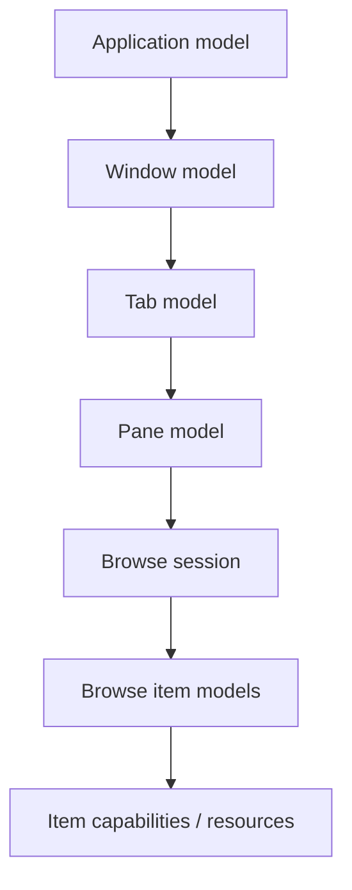

# Ownership and lifetime

ReFiles contains asynchronous and disposable resources such as storage models, provider sessions, streams, thumbnail/preview resources, browse generations, Shell COM objects, STA workers, and operation-host connections.

> Ownership means responsibility for lifetime, cancellation, cleanup, and disposal.

## Ownership hierarchy

At a conceptual level, longer-lived application state owns shorter-lived state:



Concrete types can change; the important part is that ownership remains explicit.

## Browse ownership

A browse session owns the work/resources associated with its active browse state unless a contract explicitly transfers ownership.

When navigation is superseded:

1. previous work becomes stale;
2. cancellation is requested;
3. stale results are rejected even if cancellation arrived late;
4. resources exclusive to the old generation are released when safe.

Cancellation asks work to stop. Disposal releases ownership. They are related, not interchangeable.

## Presentation ownership

ViewModels and presentation adapters generally **borrow** Core state. Displaying a model does not imply permission to dispose it. Conversely, Core must not own WinUI controls or UI-specific resources.

## Operation server ownership

Client connections, in-flight server requests, and accepted operations each hold independent server activity leases. Closing a client cancels its outstanding observation requests and releases its connection; it does not cancel accepted work. A server operation owns its cancellation source until execution and cancellation callbacks finish.

The server exits after 30 seconds without activity. Terminal history alone does not keep it running, and history is currently in memory. UI termination resilience applies to the complete storage commands submitted to the server, including their item loops. UI-owned native Shell interactions and browse reads remain separate. Server crash recovery and a persistence journal are later milestones.

## Streams and owned results

Every stream/resource-returning contract should make clear:

- who created it;
- whether the caller owns it;
- whether it may outlive the provider/item/session;
- what cancellation invalidates;
- whether disposing a parent also disposes the child.

Useful vocabulary:

- **borrowed reference** — usable by the caller, not disposed by the caller;
- **owned result** — disposal responsibility transfers to the caller;
- **shared lifetime** — validity is tied to another owner/session.

## Thumbnail and preview resources

The pipeline may use immutable buffers, streams, temporary files, COM handlers, and decoded UI images. The Core/presentation boundary must keep these ownership rules clear; Core should not retain UI image objects merely because presentation created them.

## COM resources

Shell objects may be apartment-bound. Do not cache COM objects across arbitrary async/thread boundaries unless they are known to be agile or are explicitly marshalled. Prefer stable identities/data that allow the object to be reacquired on an appropriate apartment.

## Async disposal

Keep cleanup asynchronous through the ownership chain when cleanup itself is asynchronous. Avoid sync-over-async on UI-sensitive paths, especially patterns such as:

```csharp
DisposeAsync().AsTask().GetAwaiter().GetResult();
```

unless the implementation proves cleanup cannot depend on the blocked context.

## Failure during construction

Factories/builders that acquire multiple resources must release already-acquired resources if a later step fails. Partial construction does not remove ownership obligations.

## Common mistakes

- disposing a borrowed Core model from presentation;
- assuming cancellation automatically disposes resources;
- publishing after a generation was superseded;
- caching apartment-bound COM objects in long-lived generic models;
- returning streams without ownership documentation;
- blocking the UI thread on async cleanup;
- letting event subscriptions keep panes/sessions alive.

## Tests

Protect disposal hierarchies, canceled-navigation cleanup, stale-publication rejection, stream ownership, partial-construction cleanup, async disposal completion, and retained-object behavior after navigation.

## Tab restoration

`TabRestoreState` captures every pane's restoration factory, the split orientation, and the active-pane index. Browse content captures the complete immutable navigation history, including its current cursor. Factories borrow application services and create new content; they do not retain live models or the original tab.

`WindowSession` owns duplication and the closed-tab stack. A restored tab becomes visible only after all panes initialize. A failed attempt disposes every partial pane and leaves the closed state available for retry. Presentation delegates these operations to the window session. Closing the last UI tab still follows the application's window-close policy.
