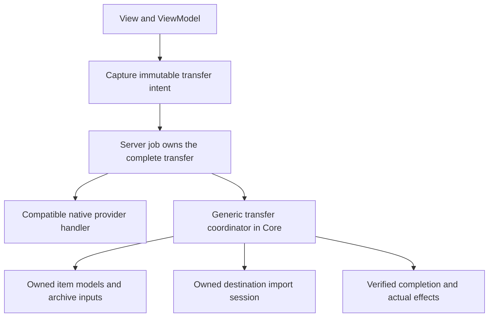

# Cross-source storage transfers

Status: file-transfer slices 1 and 2 are implemented. Tree traversal, batch archive extraction, additional destinations, and generic cross-source Move remain follow-up work. Sections describing those later slices are proposals.

## Implemented entry points

`AddStorageTransfers` registers the Core fallback after native handlers. Copy/Move now carry `StorageItemLocator` values; their existing reference constructors remain available. `StorageItemLocator.Capture` preserves exact archive provenance before selected models are disposed. `BrowsePaneSession.TransferSelectionAsync` and `TransferItemsAsync` submit complete captured batches through the configured execution boundary.

The WinRT client uses `StorageTransferData` and a flat `ArchiveLocatorStepData` array. The server validates and preflights the complete request before `OperationHost` accepts it. FTP connections are registered explicitly through `RegisterFtpConnection`, separately from transfer intent. The server owns the source and credential resolver after registration; password updates preserve the configured account and endpoint identity. Client disconnection does not dispose these sources.

The file implementation uses an internal `IStorageImportProvider` and owned `IStorageImportFile`. A folder import session is unnecessary until tree transfers are implemented. Only the Windows composition adapter knows about the Windows import implementation. It validates the destination/name, stages locally, completes the source stream, and finalizes through the existing Shell Move operation. Cleanup checks the remaining staging identity and does not remove a replacement or an acknowledged published destination.

`StorageTransferOutcome` records publication, phase, bytes, committed count, and the last acknowledged destination independently of the success-only `ResultItem`. Both local batches and server observation retain preceding commits on later failure. Publication failures without acknowledgement remain unknown and are not retried automatically.

This slice copies file names and content. Generic metadata preservation, recursive folders, archive writes, encrypted-archive credential dialogs in the server, and virtual Shell destinations are not implemented. Existing provider-native operations retain their own metadata behavior. Archive credential resolvers can still be supplied by a headless Core owner.

## Decision and first scope

Keep one Copy/Move intent and one operation-owned transfer coordinator. Existing provider handlers retain native operations when they support both endpoints. A generic fallback reads through existing storage models and imports through a destination adapter. Do not implement a separate handler for every source/destination pair.

The first usable slice is **file Copy from FTP or a selected archive record into a Windows file-system folder**, executed entirely by the existing server job. Folder trees and batch archive extraction come next. Existing Windows-to-Windows and same-source FTP behavior is preserved.

| Request | Route and limit |
| --- | --- |
| Windows file-system item to Windows file-system folder | Existing Windows handler and Shell operation scheduler. |
| FTP file to Windows file-system folder | Generic reader, staged Windows import, then confirmed publication. |
| Selected 7z/ZIP record to Windows | Job-owned archive model and exact record selection. Folder contents require the later tree/batch slice. |
| The archive container file itself to another source | Copy the container bytes. Opening an archive is not implicit extraction. |
| Nested archive record to Windows | Reopen and prepare the complete container chain within the job. |
| Any source to a virtual Shell destination | Unsupported until that destination has an explicit import adapter. Shell membership alone is insufficient. |
| Windows/archive to FTP | Later FTP import adapter using the same coordinator. |
| Generic cross-source Move | Deferred until the source can safely complete removal of the copied item. |
| Move an entry out of a read-only archive | Reject before mutation; archive rewriting is a separate feature. |

No OwlCore dependency, mutable-folder API, generic write extension on `IFile`, transaction framework, durable replay, or global archive-session pool is needed.

## Gaps addressed by the first file slices

- Copy/Move previously carried only `StorableReference`; archive selections now use independently resolvable locators.
- The legacy `StorageOperationData` has no archive selector; typed transfer submission now projects the complete container chain separately.
- `StorageOperationExecutor` now enables archive transfers and explicit server-owned FTP registration. A client-side source alone still does not register a server connection.
- Windows and FTP handlers accept transfers only when they own both references. `StorageOperationService` picks the first compatible handler; it must not retry another strategy after mutation starts.
- `StorageOperationResult` still reserves `ResultItem` for success, while its separate `Transfer` value and server summary preserve acknowledged effects before failure is propagated.
- `FtpOwnedStream.DisposeAsync` completes the data transfer and can fail after all bytes have been read. EOF alone is insufficient.
- Archive entry reads already verify content and return independent temporary streams, but repeating them can decode a solid block repeatedly.

## Ownership and dependency direction

Presentation captures selection and displays progress, decisions, and outcomes. Core owns traversal and transfer semantics. The server owns provider configuration, execution, cancellation, credential requests, and cleanup. No ViewModel, live item, stream, capability, native pointer, or browse-session reference crosses WinRT.

Use the existing `IStorageJobService`, `OperationHost`, and interruption protocol. Closing a tab or losing observation does not cancel an accepted job. A lost acceptance reply or unknown outcome must not automatically resubmit mutations.

## Transfer source values

Copy/Move sources use a small discriminated `StorageItemLocator`:

| Variant | Value |
| --- | --- |
| Configured item | A normal `StorableReference`, resolved by the server's configured workspace. |
| Archive record | `ArchiveLocator`, exact physical record ID, and expected normalized path. |
| Archive folder | `ArchiveLocator` and normalized logical folder path; an empty path explicitly selects the archive contents. |

Files with identical paths remain separate records. Folders use the common provider's logical hierarchy. Capture these values from `IArchiveEntry` while the selected model is alive. Never substitute the outer container reference for a selected archive entry: a native handler could otherwise copy or delete the whole archive.

Copy/Move requests carry this source value and keep constructors accepting a normal reference. Native handlers explicitly match a configured-item variant. The destination remains a configured folder reference while archive writing is unsupported. There is no second ambiguous `Item` field containing the outer archive.

The WinRT projection should use bounded value DTOs and validate kind, offsets, nesting, and paths before execution. A flat `StorageTransferData[]` plus `ArchiveLocatorStepData[]` method input can represent the chain without arrays inside WinRT structs. Use a new typed/versioned transfer submission entry point; retain the existing method for existing clients and non-transfer operations. Both enter the same operation host and coordinator. This is a transport adaptation, not a second Copy/Move engine.

`LastKnownAddress` remains a hint, not proof of identity or permission. The server must resolve the configured source and apply its identity guarantees. Do not infer a connection or credentials from a source ID.

## Preparation and consistency

Acceptance means that the server owns the intent, not that it has captured historical content. Preparation resolves current items when execution starts, before destination writes. Compare any reliable expected provider revision available from capture; report a mismatch. Providers without a reliable revision must be described as copying current content at preparation time. Size, timestamp, path, and an archive record index are not universal incarnation tokens.

Prepare each selected container once per job and keep its input alive through extraction. For nested selections, open child input from the already prepared parent record rather than resolving the configured outer source again for every child. Add a focused managed open-child operation to `ArchiveModel` when this slice is implemented. Its returned model owns independent verified input. A job-local preparation scope can group selections; a shared application cache or reference-counted pool is unnecessary.

Ordinary FTP files should stream directly into destination staging. Only archive input that requires random access needs full materialization. The current local archive input pin and remote materialization provide useful per-open behavior; they do not establish a universal immutable revision contract.

Configure FTP profiles and an execution-scoped credential resolver in the server before advertising support. Profile/credential registration must be explicit, independently owned, and usable after UI exit. Keep passwords out of transfer DTOs, locators, diagnostics, and logs. Reuse the job's bounded interruption/decision mechanism for credential requests.

## Destination import boundary

Add operation-side `IStorageImportProvider`, `IStorageImportSession`, and a staged-file result under `Files.Core/Storage/Operations/Transfers`. Keep the first implementation internal until a real extension consumer requires public API.

- A provider checks whether it supports the actual destination and requested semantics, then begins an owned import session.
- A session creates destination folders and stages files beneath its destination. It validates every child name and records folders already created as observable effects.
- A staged file owns its output stream and temporary item. The coordinator borrows the stream while producing content. Finalization closes/flushes output, applies the requested metadata policy, and publishes the completed item through an explicit commit method.
- Disposal removes only staging owned by that session. It never recursively removes a pre-existing destination or assumes an entire partially copied tree can be rolled back.

The coordinator handles ordering, traversal, interruption decisions, and outcomes. The adapter owns destination naming rules, staging, collision races, replacement semantics, metadata support, and native execution. `CanHandle` reports support, not authorization; execution still validates permissions.

For Windows file-system destinations, stage in the destination volume using exclusive creation. Extend the existing Shell operation wrapper/scheduler to finalize the staged item and return its actual resulting reference and acknowledged effects. Do not create ad hoc P/Invokes or infer success from a requested path. Shell finalization is not a promise of whole-operation atomicity; errors or disconnects after publication can leave an outcome uncertain.

A future FTP adapter uploads to a unique temporary remote name, awaits the final transfer response, then uses supported rename/publication behavior. Do not promise atomic replacement across servers. An endpoint unable to provide the required semantics must reject that mode or expose its weaker result explicitly.

## Execution and completion

For a normal file, execute:

1. Resolve the owned source and destination session; validate support and the conflict policy.
2. Open source content and destination staging.
3. Copy with bounded buffering, progress, and cooperative cancellation.
4. Await source completion/disposal, then finalize destination output. For FTP, a failed final response stops here.
5. Commit the destination and record its actual reference/effect before processing cancellation or the next item.
6. For an allowed Move, remove the exact prepared source only after confirmed publication and record that separate effect.

Do not truncate or delete an existing destination before source verification. A Skip decision never deletes a Move source. Cancellation before commit cleans staging; cancellation after an acknowledged commit retains the committed result. A folder can be partially published, so earlier successful children must remain visible in the result.

Preserve Fail, GenerateUniqueName, and Prompt behavior. Destination adapters revalidate conflicts at commit time; a prior existence check does not authorize overwriting a replacement item. File/folder and case collisions need explicit destination decisions. The source's ordinal archive names do not define Windows or FTP name equivalence.

Traverse progressively with bounded buffering and concurrency. Byte totals can be unknown; do not scan an entire tree merely to produce a percentage. Reject known self/descendant transfers, do not follow links by default, and apply depth/cycle/work limits. Different source IDs do not prove that physical storage cannot alias. Destination providers validate containment, reserved names, alternate-stream syntax, case rules, and reparse behavior. Never turn untrusted archive paths directly into destination filesystem paths.

## Archive batch extraction

After single-file correctness, add a managed batch extraction method to `IArchiveReadSession`, surfaced through an operation on `ArchiveModel`. Pass selected record IDs and a managed sink that lends one staging stream per record and receives a verified completion or failure for that record. The reader must leave borrowed sink streams under sink ownership.

The SevenZip adapter submits sorted physical indices in one native extraction call per prepared batch and maps callbacks back to exact record IDs. Commit a record only after its completion result passes CRC/authentication and output finalization. If an unrecoverable native failure has uncertain scope, leave affected pending records uncommitted. Preserve already acknowledged effects.

Native callbacks are synchronous. Use bounded prepared batches so destination decisions and asynchronous finalization occur outside callbacks; callbacks only supply prepared staging streams and record completion. Do not invoke presentation or hold the Shell operation STA while decoding. Measure the batching tradeoff for solid archives instead of hiding per-file extraction behind an async callback API.

The pinned SevenZipSharp fork's public `ExtractFiles(ExtractFileCallback)` loops over `ExtractFile`; using it would not provide this optimization. Add a focused managed batch/sink entry point in that wrapper, retaining its native declarations and callbacks internally, and rebuild the pinned package with the source change recorded. Do not recreate raw COM interfaces in Core or extract untrusted paths directly into a directory merely to use the existing directory overload.

Keep `OpenReadAsync` for preview, nested input, and small reads. Its independent temporary file is useful there. Do not use one `OpenReadAsync` call per file as the permanent implementation of large solid-archive extraction, and do not expose raw 7-Zip callbacks outside the adapter. The batch contract must support records being skipped because of a destination conflict without changing record identity.

## Move and partial results

There is no atomic cross-provider Move. Treat it as confirmed destination publication followed by source removal under a provider-specific guarantee. A source adapter must prove it is removing the prepared item, not an item recreated at the same path. FTP path identity plus size/mtime checks does not prove this. Start with Copy; admit generic Move only when the source offers the required removal guarantee. Keep currently supported native Move routes intact.

`StorageOperationResult.Transfer` now preserves publication state, the last known destination, bytes, committed count, and execution phase. Source-removal state belongs to the later generic Move slice. The publication states distinguish no publication, confirmed publication, partial publication, and unknown publication. Failed source deletion must eventually report a committed destination without claiming overall success.

Record the outcome in `StorageOperationBatch` **before** propagating failure, and project it through `OperationHost`, `OperationSummary`, and the client monitor. Keep terminal data bounded per selected top-level item; progressive per-entry events need not become an unbounded in-memory manifest. A copied folder's destination root and counters identify partial effects. Any later detailed report store is separate from crash replay.

Never infer absence of effects from an exception, a canceled token, or less than 100% progress. Preserve unknown outcomes and do not retry publication or deletion automatically. A lost server process still requires future recovery work; this plan does not imply a durable journal.

## Implementation sequence and acceptance

| Slice | Main changes | Required proof |
| --- | --- | --- |
| 1. Intent and results | Source locators in the request types under `Storage/Operations/Requests`; immutable selection capture in Core; DTO projection in `WinRTStorageOperationService`; server validation; structured effects and result recording. | Archive selection survives tab closure; duplicate records remain distinct; malformed chains fail; old native routes retain behavior; committed destination survives failed deletion in the result. |
| 2. Working file Copy | `Storage/Operations/Transfers` coordinator, destination staging, Windows import adapter; explicit server FTP/archive composition and credential ownership. | FTP-to-Windows and archive-record-to-Windows via real server jobs; final FTP response failure, CRC failure, access denial, cancellation, conflict race, and staging cleanup. UI exit must not end an accepted job. |
| 3. Trees and archive batches | Progressive traversal, safe destination mapping, prepared parent/child archive models, managed batch sink and SevenZip adapter. | Nested archives, solid archives, duplicate/case/file-folder collisions, unsafe names, links, overlapping selection, partial publication, bounded memory, and one prepared container per group. Measure decoding work, not only wall-clock time. |
| 4. Additional destinations and Move | FTP import; source removal guarantees only where implementable. | Upload-finalization failures, unsupported rename/replace, copied-but-not-removed outcomes, source replacement before deletion, and disconnects at publication boundaries. Read-only archive Move stays unsupported. |

Each slice should leave existing native routes usable and include its own focused tests and commit. Do not build archive writers, virtual Shell import, a generic content-version framework, or replay machinery to finish the first two slices.
