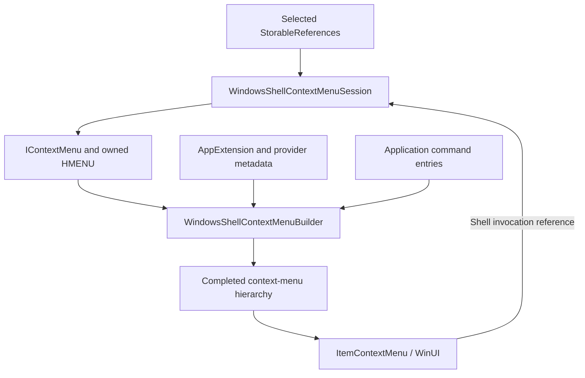

# Context-menu construction

Explorer separates native command discovery, curated-menu composition, and XAML rendering. ReFiles uses the same responsibility boundaries while keeping application commands routed through `WindowCommandManager`.

## Verified native implementation

Headless IDA analysis of x64 `shell32.dll` version `10.0.26100.9278` established:

| Function | Address | Responsibility |
| --- | --- | --- |
| `SHCreateDefaultContextMenu` | `0x180082270` | Constructs and initializes `CDefFolderMenu`, then queries the requested interface. |
| `CDefFolderMenu::QueryContextMenu` | `0x180016db0` | Merges built-in commands, callbacks, and extension handlers into an `HMENU`. |
| `CRegistryVerbArray::AddStateRepoVerbs` | `0x1800c8378` | Uses `StateRepoVerbsCache_GetContextMenuVerbs` and adds Cloud Files verbs. |
| `CDefView::_CreateSelectionContextMenu` | `0x1801e04ac` | Obtains and adjusts the selection's context-menu object. |
| `CDefView::_DoContextMenuPopup` | `0x1802c2ffc` | Populates the native menu and selects the curated or expanded presentation path. |

The separately analyzed `Windows.UI.FileExplorer.dll` presenter snapshot records `PrepareForContextMenu` accepting an existing `IContextMenu`. Its `TryCreateMiniMenuFromClassic` filters the native menu and inserts AppExtension placeholders. `ExtractCloudProviderVerbs` moves existing `MakeAvailableOffline` and `MakeAvailableOnline` entries into the provider section. The presenter converts the composed result to WindowsUdk menu-item objects; FileExplorerExtensions handles the XAML view and asynchronous icon updates.

These snapshots establish the responsibility boundaries. They are not a single version-matched runtime trace. Private symbols, addresses, host services, and query flags require revalidation when Windows changes.

In `Windows.UI.FileExplorer.dll` version `10.0.26200.9711`, `FetchDetailsForAppExtension` (`0x1800b3fcc`) replaces a group with its sole visible command and retains a parent for multiple commands. `IsL1Default` does not determine submenu cardinality. `AddCloudProviderVerbs` obtains the selection's file-system path and calls `ISyncRootManager.GetStorageProviderInfoFromPath`.

`InsertAppExtensionPlaceholdersIntoMiniMenu` (`0x1800bc160`) keys its case-insensitive ordered map by `GetDisplayName`, not package identity. The accessor at `0x18003bb0c` calls the first extension method at ABI offset 48; the separate package accessor at `0x18003c3f8` calls offset 56. Decompiler-generated XAML accessor names at these shared wrappers are misleading. ReFiles retains package identity for invocation and resources while ordering parent groups by the original extension display name.

`FileExplorerExtensions.dll` from the same build uses `GetIconFilenameForContextMenuVerb` (`0x180017098`) and `MenuFlyoutControl::SetImageIcon` (`0x180032c54`) to prefer system SVG assets over command bitmaps. The two pin verbs map to `MakeAvailableOffline.svg` and `MakeAvailableOnline.svg`. `UpdateSvgIcon` selects theme and contrast through its asset resolver. ReFiles resolves the registered `MicrosoftWindows.Client.FileExp` package location and reads the corresponding installed theme assets; it does not redistribute them.

`ContextMenuPresenter::ResolveIconFromCommandStore` (`0x1800caa94`) supplies a separate fallback by obtaining `IExplorerCommand` from `CLSID_CommandStore`. The command-store ABI was checked against `Windows.Storage.dll` version `10.0.26100.9278`: `CCommandStore::GetCanonicalCommand` is the first method after `IUnknown` (`0x18027a860`).

## ReFiles implementation

`WindowsShellContextMenuSession` resolves the complete selection, acquires `IContextMenu` through `BHID_SFUIObject`, and retains native state on the source's single operation STA. Flat selections must have one Shell parent. A selection that cannot expose one native menu falls back to application entries.

The session preserves native command offsets and original `IExplorerCommand` objects for invocation. It owns native icon references until queued reads finish. Closing rejects new work and queues cleanup after already accepted operations. UI cancellation rejects late results without invalidating an in-flight invocation.

`WindowsShellContextMenuBuilder` determines section order, extension grouping, and separators. AppExtension catalogs provide metadata rather than a finished popup. Cloud pin commands use their native labels, checked/enabled state, and invocation targets; ReFiles does not synthesize those commands with `CfSetPinState`.

`ItemContextMenu` renders the completed tree and maps application command identities back to existing bindings. Icon decoding and WinUI objects remain in `Files`. Icons load after the top-level hierarchy is established.

The implementation shares these construction boundaries, but does not host Explorer's private service provider or WindowsUdk XAML controls. Standard application commands remain supplied by Files. Arbitrary owner drawing and dynamic classic submenus are supported by the expanded native menu, not projected into the curated menu.

The expanded native menu remains responsible for arbitrary classic handlers, including owner drawing and dynamic submenus. Its owner-window callbacks execute on the UI STA rather than accessing a worker-owned COM object.

## Cache and ownership rules

- Cache registration metadata and independent resource data, not an item's enabled/checked state for a fixed time window.
- A popup snapshot belongs to one selection and one session.
- Native command ordinals are valid only with the context-menu object and ID range that produced them.
- A rendered entry does not transfer native ownership to a WinUI control.
- Finish an accepted invocation before disposing its session, and dispose sessions before the storage source.
- Share icon-load tasks within a session; cancellation of one wait must not cancel another caller's load.

## Validation

`WindowsShellContextMenuTests` covers composition, separator normalization, mnemonic interpretation, nonconforming ANSI canonical verbs, foreign command rejection, and teardown after queued work. Provider-specific parity requires real local and cloud selections.

Use `--shell-menu-scenario <paths>` in `Files.Benchmarks` for three fresh sessions per path, including construction time, icon completion, and final hierarchy. These timings depend on installed extensions and must remain separate from deterministic Core benchmarks. The scenario does not invoke commands.
